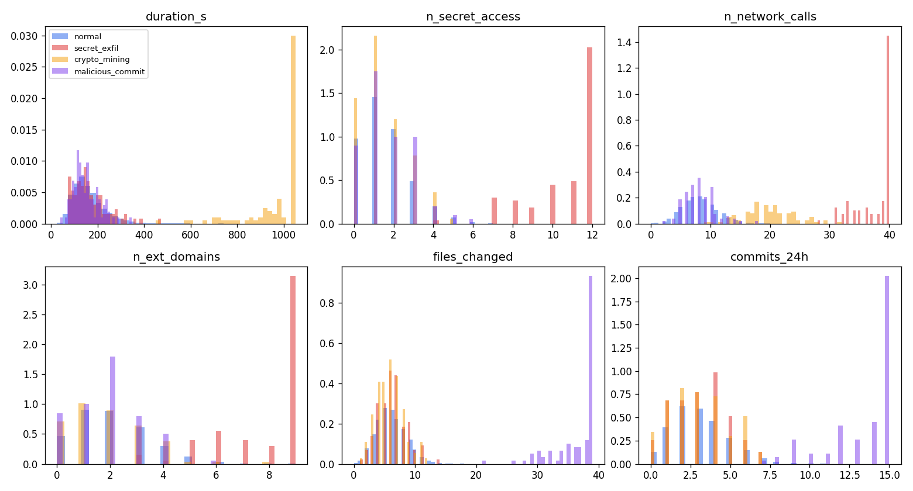
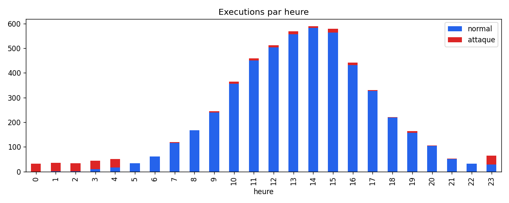
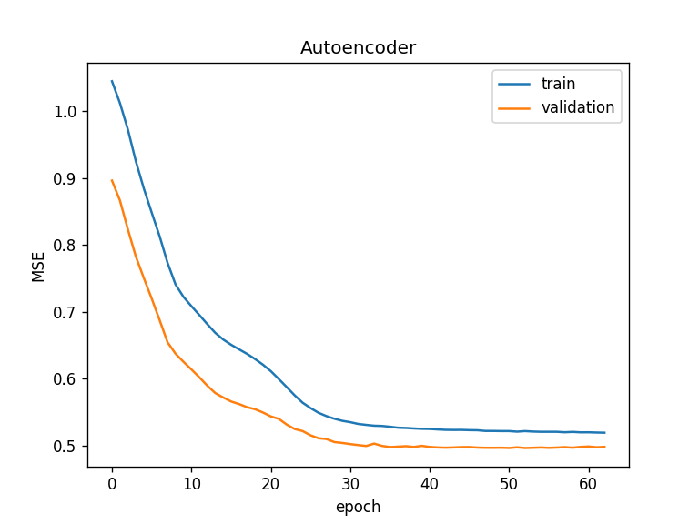
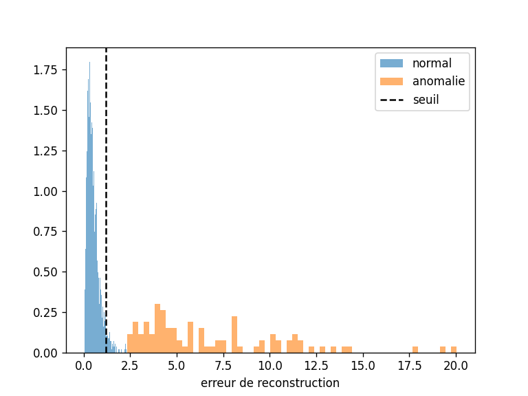
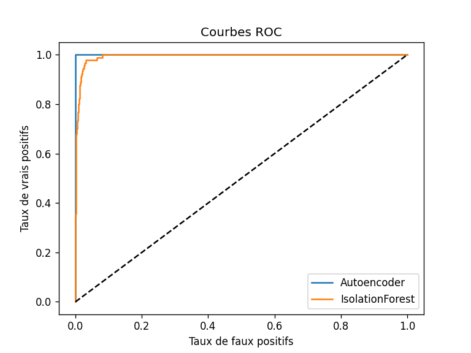

# Détection d'anomalies dans les pipelines CI/CD

Modèle hybride **Autoencoder + Isolation Forest**, exécuté sous **Docker**, pour détecter les exécutions de pipelines suspectes (vol de secrets, cryptomining, commits malveillants).

## Jeu de données

`data/cicd_logs.csv` : 5 300 exécutions de pipeline, 11 variables (heure, durée, nombre de commandes, accès aux secrets, appels réseau, domaines externes, fichiers modifiés, étapes échouées, nouvelle IP, commits sur 24 h), une étiquette `label` et un `attack_type` (`normal`, `secret_exfil`, `crypto_mining`, `malicious_commit`).

Ce fichier n'est pas versionné : place-le dans le dossier `data/` avant de lancer les scripts.

## Démarrage (PowerShell + Docker Desktop)

```powershell
git clone https://github.com/chaimaeouelda/cicd-anomaly-detection.git
cd cicd-anomaly-detection
docker compose build
docker compose run --rm ml python -m src.explore_data
docker compose run --rm ml python -m src.features
docker compose run --rm ml python -m src.visualize_data
```

## Structure

- `src/` : scripts Python (exploration, features, visualisation, modèles)
- `data/`, `models/`, `reports/` : données, modèles entraînés, graphiques (non versionnés)
- `Dockerfile`, `docker-compose.yml`, `requirements.txt` : environnement reproductible
## Visualisation du dataset

Distribution des variables clés, par type d'exécution (les attaques se démarquent du trafic normal) :



Exécutions par heure (les attaques se concentrent la nuit) :


## Résultats des modèles

Courbe d'entraînement de l'autoencoder (l'erreur diminue sur les données d'entraînement et de validation) :



Erreur de reconstruction de l'autoencoder : les exécutions normales et les attaques sont séparées, la ligne pointillée est le seuil (95e percentile du trafic normal) :



Courbes ROC de l'autoencoder et de l'Isolation Forest sur le jeu de test :

