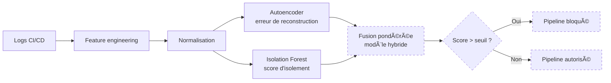

# Détection d'anomalies dans les pipelines CI/CD

Modèle hybride **Autoencoder + Isolation Forest**, exécuté sous **Docker**, pour détecter et bloquer les exécutions de pipelines suspectes (vol de secrets, cryptomining, commits malveillants).


## Progression (suivi de certification)

**55 % complété** : semaines 1 et 2 terminées.

| Semaine | Contenu | Poids | État |
|---|---|---|---|
| 1 | Setup Docker + Données | 25 % | ✅ Terminée |
| 2 | Autoencoder + Isolation Forest | 30 % | ✅ Terminée |
| 3 | Modèle hybride + API + intégration CI/CD | 25 % | ⏳ À faire |
| 4 | Évaluation, tests, rapport | 20 % | ⏳ À faire |

Détail des tâches : [docs/PROGRESS.md](docs/PROGRESS.md)

## Architecture



Les blocs en pointillés (hybride, API, blocage) correspondent à la semaine 3.

## Structure du dépôt

```
cicd-anomaly-detection/
├── src/
│   ├── check_env.py          # vérification de l'environnement
│   ├── generate_data.py      # génération des logs (normal + 3 attaques)
│   ├── features.py           # feature engineering + normalisation
│   ├── ae_model.py           # architecture de l'autoencoder
│   ├── train_autoencoder.py  # entraînement de l'autoencoder
│   ├── eval_autoencoder.py   # erreur de reconstruction + seuil
│   ├── train_iforest.py      # entraînement de l'Isolation Forest
│   └── compare_scores.py     # comparaison + export des scores
├── data/  models/  reports/  tests/
├── docs/PROGRESS.md
├── Dockerfile
├── docker-compose.yml
├── requirements.txt
└── run_all.ps1               # exécute tout le pipeline
```

## Démarrage rapide (PowerShell + Docker Desktop)

```powershell
git clone https://github.com/chaimaeouelda/cicd-anomaly-detection.git
cd cicd-anomaly-detection
.\run_all.ps1
```

Ou étape par étape :

```powershell
docker compose build
docker compose run --rm ml python -m src.generate_data
docker compose run --rm ml python -m src.features
docker compose run --rm ml python -m src.train_autoencoder
docker compose run --rm ml python -m src.eval_autoencoder
docker compose run --rm ml python -m src.train_iforest
docker compose run --rm ml python -m src.compare_scores
```

## Données simulées

| Classe | Comportement |
|---|---|
| `normal` | Activité de pipeline habituelle (5000 exécutions) |
| `secret_exfil` | Nombreux accès aux secrets et domaines externes, de nuit, IP inconnue |
| `crypto_mining` | Durée anormalement longue, de nuit |
| `malicious_commit` | Beaucoup de fichiers et de commandes, IP inconnue |

## Méthode

- **Autoencoder** (11 → 8 → 4 → 8 → 11) entraîné sur le trafic normal uniquement ; le score est l'erreur de reconstruction, le seuil est le 95e percentile du normal.
- **Isolation Forest** (200 arbres) entraîné sur les mêmes features.
- **Hybride** (semaine 3) : fusion pondérée des deux scores normalisés.
